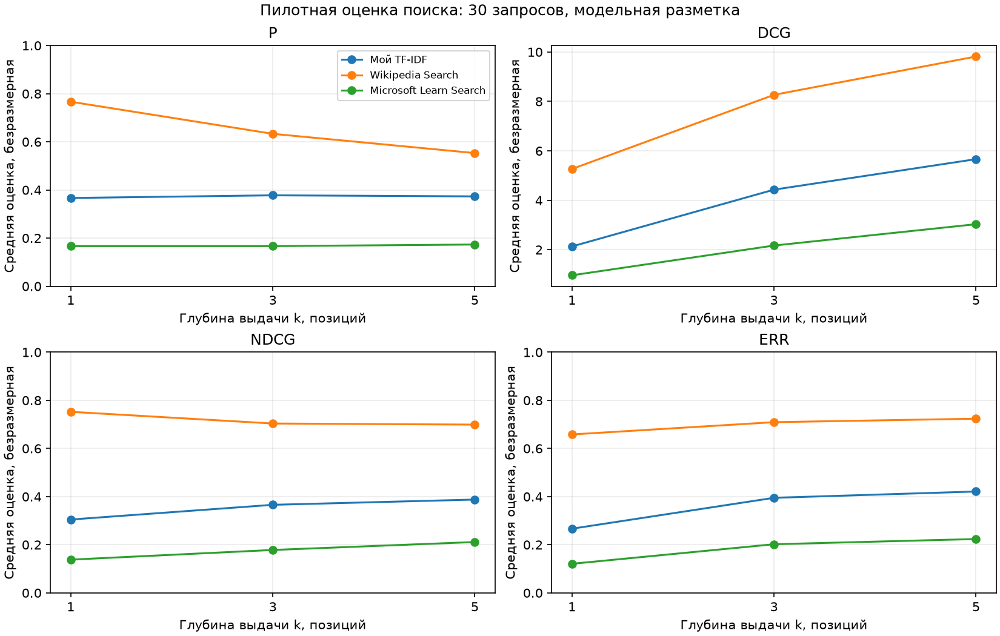

# Оценка качества поиска: алгоритм, проведение эксперимента и разбор результатов

## 1. Зачем оценивать качество работающего поиска

Работающий поиск и полезный поиск — не одно и то же. Программа может правильно прочитать индекс, найти документы с термами запроса и отсортировать их по cosine score, но поставить наверх материал, который человеку не нужен. Например, слово `surface` встречается и в названии семейства устройств Microsoft Surface, и в термине `surface code` из квантовой коррекции ошибок. Совпадение слова ещё не определяет намерение пользователя.

Оценка качества нужна, чтобы проверить, насколько первые результаты помогают решить конкретную информационную задачу. В этом эксперименте задача описывается обычным англоязычным запросом и отдельным пояснением ожидаемого ответа. Затем оценивается не внутренняя уверенность поисковика, а содержание найденных документов относительно этого ожидания.

Поэтому необходимо различать три числа. **Cosine score** вычисляет поисковый алгоритм по весам термов. **Оценка релевантности** от 0 до 3 назначается при просмотре содержания: насколько документ отвечает намерению. **Метрика качества** объединяет эти оценки и позиции в выдаче в один показатель, например P@5 или NDCG@5. Высокий cosine score сам по себе не гарантирует оценку релевантности 3, а высокая релевантность одного документа ещё не означает, что вся выдача хорошая.

Эта оценка является пилотной: документы реально найдены поисковиками, но первичная содержательная разметка выполнена языковой моделью по сохранённым фрагментам. Её можно перепроверить и исправить. Она не выдаётся за независимую разметку группы людей.

## 2. Общая схема эксперимента

Сначала фиксируются запросы и версия собственного индекса. После этого одна и та же строка запроса отправляется в несколько поисковых систем. У каждой системы сохраняется порядок результатов; документы не переставляются вручную ради улучшения показателей.

```text
30 запросов и описание ожидаемых ответов
                    │
                    ▼
       Получение реальных выдач
       TF-IDF / Wikipedia / Microsoft Learn
                    │
                    ▼
       Сохранение первых 10 результатов
                    │
                    ▼
       Объединение первых 5 позиций
       и сопоставление одинаковых URL
                    │
                    ▼
       Тексты и фрагменты документов
                    │
                    ▼
       Оценки 0–3 с обоснованиями
                    │
                    ▼
       P, DCG, NDCG, ERR на @1, @3, @5
                    │
                    ▼
       Средние показатели и анализ ошибок
```

В этой схеме поиск и его оценивание разделены. C++-программа отвечает за получение ранжированного списка. Обвязка сохраняет наблюдения и вычисляет метрики по отдельной разметке. Она не использует cosine score как готовую оценку релевантности и не назначает полезность по числу совпавших слов.

Содержательная оценка привязана к паре «запрос — документ». Один и тот же документ может быть хорошим ответом на один запрос и плохим на другой. Например, руководство по файловым junctions полезно для администрирования Windows, но не отвечает на вопрос о полупроводниковом p–n-переходе. В то же время один URL, найденный разными системами для одного запроса, получает одну общую оценку: его содержание не становится полезнее из-за имени поисковика.

## 3. На какие исследовательские вопросы отвечает работа

Первый вопрос — насколько полезны первые результаты моего TF-IDF на разнообразных технических запросах. Для ответа используются средние метрики, но вместе с ними сохраняются показатели каждого запроса: одинаковое среднее может скрывать как ровное качество, так и сочетание нескольких отличных выдач с несколькими полными провалами.

Второй вопрос — чем моя выдача отличается от доступных существующих поисков. Здесь важно не ограничиваться фразой «одна система лучше другой»: поиски работают по разным наборам страниц. Поэтому отдельно проверяется, есть ли удачный документ внешней системы в моём индексе. Если он есть, но мой поиск не поднял его в первые результаты, это свидетельствует о проблеме отбора или ранжирования. Если его нет, сравнение затрагивает также полноту корпуса.

Третий вопрос — какие классы запросов вызывают ошибки. Для этого рассматриваются конкретные примеры: неоднозначные термы, специальные имена языков и платформ, широкие обзорные запросы и узкие вопросы о продукте. Такие наблюдения помогают выбрать следующий эксперимент. Они не заменяют контролируемое сравнение до и после изменения алгоритма и не доказывают статистическую закономерность по всем запросам пользователей.

Основные численные результаты приведены ниже и в [summary.csv](summary.csv). Подробные выдачи с названиями документов, ссылками, оценками и обоснованиями находятся в [results.md](results.md). Если оценка вызывает сомнение, её можно проверить по [pool.json](pool.json), где приведены просмотренные фрагменты, и по [documents.json](documents.json), где сохранены полученные тексты.



## 4. Основание и границы работы

В [README преподавателя](https://github.com/toshunster/MAI-IR/blob/main/README.md) оценка качества поиска выделена в отдельный пункт. В требованиях к результатам перечислены P, DCG, NDCG и ERR и необходимость критического анализа. Ссылка на `lesson-03` в README есть, но соответствующего каталога в текущем дереве репозитория нет. Детализация «30 запросов, две альтернативы, глубины @1, @3 и @5» взята из [архивного задания 2021 года](https://github.com/toshunster/MAI-IR/blob/main/Задания-2021.pdf), раздела «Оценка качества поиска». Архивный документ не выдаётся здесь за отдельное актуальное задание `lesson-03`.

Эксперимент оценивает полезность первых результатов для человека. Он не измеряет корректность булевых операций, скорость поиска, степень сжатия индекса или качество цитатного поиска. Эти свойства требуют отдельных тестов. Существующий синтетический тест морфологии из `results/statistics.json` также не заменяет данную оценку ранжированной выдачи.

## 5. Снимок корпуса и индекса

Использован общий индекс для булева и TF-IDF-поиска из `results/boolean_index`, версия бинарного формата 4. Он содержит **993 923 документа**, **19 009 884 терма** и **524 192 226 пар «терм — документ»**. Это число документов именно в поисковом индексе, а не число скачанных HTML-страниц.

В сохранённой статистике лингвистического пайплайна указано 1 132 727 обработанных исходных документов; после порога принятия осталось 993 923. Поэтому в этом эксперименте нельзя утверждать, что поиск оценивался на индексе более миллиона документов. Версия обработки — 9, минимальный порог — 100 токенов.

В [snapshot.json](snapshot.json) сохранены размеры и SHA-256 всех шести бинарных файлов, конфигурация поиска, статистика корпуса и контрольная сумма файла запросов. Поиск запускался штатным C++-исполняемым файлом `tfidf_search`; его алгоритм для эксперимента не изменялся. Python использовался для запуска программы, получения внешних выдач, хранения наблюдений и расчёта метрик.

Во время эксперимента индекс не перестраивался. Тексты, использованные для разметки, сохранены отдельно, поэтому последующие изменения сайтов или MongoDB не меняют уже полученные оценки.

## 6. Как составлены запросы

В [queries.json](queries.json) зафиксированы 30 англоязычных запросов. Для каждого записано намерение пользователя: какую информацию должен содержать полезный результат. Запросы охватывают программирование, базы данных, информационный поиск, безопасность, облачную инфраструктуру, машинное обучение, инженерное моделирование, физику и биотехнологии.

Включены технические конструкции `C++`, `C#`, `.NET` и `node.js`, а также неоднозначные слова: `transformer`, `surface`, `folding`, `graph`, `federated`, `junction`. Это позволяет проверить не только совпадение слов, но и различение их значений. Например, для `transformer attention mechanism` ожидается объяснение нейросетевого внимания, а не устройство электрического трансформатора.

Это намеренно подобранная небольшая выборка, а не случайная выборка из журнала реальных пользователей. Она пригодна для выявления характерных ошибок, но не доказывает качество на всех возможных запросах. Основной набор зафиксирован до пакетного запуска собственного поиска; запрос об изоляции транзакций также использовался при первоначальной проверке доступности внешних систем. Контрольная сумма запросов проверяется при пересчёте метрик.

## 7. Какие системы сравнивались

**Мой TF-IDF.** Все запросы одним пакетом поданы в стандартный ввод `./.build/tfidf_search configs/search.yaml`. Сохранён исходный консольный вывод. Из него извлечены первые десять результатов с исходными позициями, cosine score, внутренним docID, ObjectId MongoDB, названием и URL. Для оценки используются первые пять результатов без перестановки и ручной замены.

**Wikipedia Search.** Использован публичный MediaWiki API: `action=query`, `list=search`, `srsearch=<запрос>`, `srlimit=10`. Сохраняются первые десять результатов, возвращённые сервером, вместе с исходным JSON. Этот поиск работает по английской Wikipedia, а не по всему нашему трёхисточниковому корпусу.

**Microsoft Learn Search.** Использован публичный endpoint `https://learn.microsoft.com/api/search` с параметрами `search=<запрос>`, `locale=en-us`, `$top=10`. Сохранены исходные JSON и порядок результатов. Это результат данного API в момент эксперимента, а не утверждение о полностью идентичной выдаче всех вариантов веб-интерфейса Microsoft. Выдача может включать учебные модули, справочники, навигационные страницы и страницы Q&A, часть которых не входит в наш индекс.

Google при проверке вернул страницу согласия, а после штатного отказа от дополнительных cookies — страницу перенаправления без доступной HTML-выдачи. Яндекс вернул CAPTCHA; DuckDuckGo также запросил проверку. Эти страницы не обрабатывались как результаты поиска, CAPTCHA не обходилась. Поэтому они не включены в основное численное сравнение.

**Bing сохранён только как дополнительное ограниченное наблюдение.** В запрос добавлялось ограничение на домены корпуса, запрашивалось до 50 результатов, затем из фактически полученной первой страницы оставлялись адреса `en.wikipedia.org/wiki/`, `arxiv.org/html/` и `learn.microsoft.com/en-us/`. Исходный порядок сохранялся; первоначальные позиции записаны в `original_rank`. После фильтрации на 29 доступных запросах получилось только 42 позиции в первых пяти; ни для одного запроса не набралось пять результатов. Для Q17 органическая выдача не была распознана, и он помечен как недоступный, а не как нерелевантный. Значения Bing в CSV характеризуют только этот ограниченный сбор, не весь Bing. В основной график он не включён.

## 8. Как получен эталон релевантности

Для каждого запроса объединены первые пять результатов всех сохранённых систем. Одинаковые URL нормализованы: убраны фрагменты и tracking-параметры, учтено URL-кодирование. Совпавший URL в нескольких системах получает одну оценку для данного запроса. Дедупликация по смыслу и полное разрешение всех HTTP-редиректов не выполнялись; разные URL одного материала могут оставаться отдельными элементами.

Получилось **477 пар «запрос — документ»** и **458 различных URL**. Для 363 URL текст получен из `processed_documents` MongoDB, для 95 — с доступной страницы источника. Все эти тексты сохранены; в каждом случае указан источник получения. Фрагменты выбирались по наличию терминов запроса, чтобы быстро найти соответствующий участок большого текста. Это способ подготовки материалов для просмотра, а не формула оценки релевантности.

Такое объединение кандидатов называется **пулингом**. Его смысл — получить общий список документов для оценки, не перечитывая весь корпус. Если каждая система вернула пять результатов, до удаления совпадений в пуле трёх основных систем может быть до пятнадцати документов на запрос. Совпадающие адреса уменьшают число разных кандидатов. В данном опыте дополнительно использованы доступные кандидаты Bing, поэтому итоговый пул шире объединения только трёх основных систем.

Пулинг делает оценивание выполнимым, но ограничивает выводы: хороший документ, который не попал в первые пять позиций ни одной системы, может остаться неразмеченным. Поэтому отсутствие релевантного кандидата в пуле не равно отсутствию ответа во всём корпусе. По этой же причине здесь не вычисляется полнота Recall: неизвестно общее число всех релевантных документов в корпусе для каждого запроса.

Оценки выставлялись по намерению запроса, заголовку и сохранённым текстовым фрагментам. При просмотре списка фрагментов названия поисковых систем не выводились; материалы были упорядочены по URL. Это уменьшает прямую привязку оценки к поисковику, но не делает модельную разметку независимой или свободной от ошибок.

| Оценка | Смысл |
|---:|---|
| 3 | Прямой содержательный ответ на основное намерение запроса. |
| 2 | Существенный частичный ответ: отдельный механизм, практический сценарий или важная часть задачи. |
| 1 | Фон, краткое упоминание, навигация или смежная тема без достаточного самостоятельного ответа. |
| 0 | Другая тема, другой смысл терма либо отсутствие ответа на намерение запроса. |

Каждая оценка имеет текстовое обоснование в [assessments.json](assessments.json). В пуле 160 оценок 0, 151 оценка 1, 109 оценок 2 и 57 оценок 3. Эти числа относятся к уникальным парам в пуле, а не к позициям выдачи.

Некоторые исходные страницы содержат много служебного текста, а короткие страницы Q&A не всегда раскрывают полный ответ. Поэтому оценка относится к доступному сохранённому материалу. В спорном случае нужно открыть исходный URL и перепроверить её человеком. Например, нельзя считать вопрос о потере ёмкости аккумулятора полноценным объяснением механизма старения только по заголовку.

## 9. Как считаются метрики

### Что означает вся запись «P, DCG, NDCG, ERR на @1, @3, @5»

Это четыре способа оценить качество одного и того же упорядоченного списка найденных документов. Каждый способ применяется три раза: только к первой позиции, к первым трём и к первым пяти. Например, `NDCG@3` читается как «нормированная дисконтированная накопленная полезность первых трёх результатов». Документы с четвёртой позиции и ниже в это значение не входят. Всего для одной выдачи получаются 12 показателей, а не одна общая оценка.

В этом разделе **релевантность** означает соответствие документа информационной потребности пользователя. Если человек ищет механизм внимания в нейросети Transformer, статья об электрическом трансформаторе нерелевантна, хотя содержит совпавшее слово. Степень соответствия задаётся оценками 0–3 из предыдущего раздела. Метрики используют уже назначенные оценки: сами по себе они не читают текст и не определяют его полезность.

| Обозначение | Полное название | Определение и вопрос, на который отвечает метрика |
|---|---|---|
| **P** | **Precision — точность** | Доля релевантных документов среди просмотренных результатов. Отвечает на вопрос: «Какая часть первых результатов действительно полезна?» |
| **DCG** | **Discounted Cumulative Gain — дисконтированная накопленная полезность** | Сумма полезностей документов, в которой вклад уменьшается с удалением от начала выдачи. Отвечает на вопрос: «Сколько полезной информации показано и насколько высоко она расположена?» |
| **NDCG** | **Normalized Discounted Cumulative Gain — нормированная дисконтированная накопленная полезность** | Отношение DCG полученной выдачи к DCG лучшего известного порядка на той же глубине. Отвечает на вопрос: «Насколько полученный список близок к идеальному по полезности и порядку?» |
| **ERR** | **Expected Reciprocal Rank — математическое ожидание обратной позиции удовлетворительного ответа** | Ожидаемое значение `1/r`, где `r` — позиция результата, после которого пользователь сочтёт свою задачу решённой и прекратит просмотр. Отвечает на вопрос: «Насколько рано пользователь, вероятно, найдёт достаточный ответ?» |

### P: сколько результатов полезно

Precision не различает частично полезный и исчерпывающий ответ, если оба прошли установленный бинарный порог. В этом эксперименте оценки 2 и 3 считаются релевантными, а 0 и 1 — нет. Если среди первых пяти документов полезны три, P@5 = 3/5 = 0,6, то есть 60% просмотренных результатов признаны релевантными.

Значения P лежат от 0 до 1. Единица означает, что все рассматриваемые позиции релевантны, ноль — что среди них нет релевантных. При этом P@5 не изменится, если переставить те же пять документов между собой. Поэтому одной точности недостаточно для проверки порядка ранжирования. Precision также не измеряет полноту поиска: P@5 = 1 не означает, что найдены все полезные документы корпуса.

### DCG: сколько полезности накоплено с учётом позиции

Название DCG раскрывает её устройство. **Gain**, или полезность, — численный вклад документа, полученный из оценки релевантности. **Cumulative** означает, что вклады нескольких документов складываются. **Discounted** означает, что вклад поздних позиций уменьшается: пользователь вероятнее увидит первый результат, чем пятый.

В принятой формуле оценки 0, 1, 2 и 3 превращаются в полезности 0, 1, 3 и 7. Это позволяет отличить исчерпывающий ответ от краткого упоминания. Затем полезность делится на `log2(i + 1)`, где `i` — позиция документа с единицы. Для первого результата делитель равен 1, для третьего — 2. Поэтому документ с оценкой 3 на первой позиции добавляет 7, а на третьей — 3,5.

Чем выше DCG, тем больше полезности находится ближе к началу списка. Однако у DCG нет универсального максимума 1. Максимум зависит от глубины и шкалы оценок. Кроме того, для одного запроса может существовать много исчерпывающих ответов, а для другого — лишь один частичный. Это затрудняет интерпретацию ненормированных значений между запросами и мотивирует использование NDCG.

### NDCG: насколько выдача близка к лучшему известному порядку

Сначала вычисляется **IDCG — Ideal Discounted Cumulative Gain**, то есть DCG идеальной выдачи. Для этого берутся оценки всех уникальных документов, размеченных для данного запроса, сортируются от большей к меньшей и выбираются первые `k`. Затем DCG реальной выдачи делится на эту идеальную величину.

При согласованном общем пуле NDCG находится от 0 до 1. Значение 1 означает, что на выбранной глубине система достигла идеальной полезности; при одинаковых оценках нескольких документов единственный идеальный порядок может отсутствовать. Значение 0,8 означает получение 80% идеальной дисконтированной полезности, а не 80% релевантных документов и не «80% правильных ответов».

Идеал здесь ограничен размеченным пулом кандидатов. Если все поисковики пропустили лучший документ, он не попадёт в IDCG. Поэтому NDCG = 1 означает близость к известному эталону, но не доказательство совершенства поиска по всему корпусу.

### ERR: как быстро найден ответ, после которого можно остановиться

ERR использует модель последовательного просмотра. Пользователь начинает с первого результата. На каждой позиции он может удовлетвориться документом и остановиться либо перейти дальше. Вероятность удовлетворения определяется его оценкой релевантности; в нашем варианте оценкам 0, 1, 2 и 3 соответствуют вероятности 0, 1/8, 3/8 и 7/8. Это допущение формулы, а не наблюдение за реальными пользователями проекта.

Если достаточный ответ находится на позиции `r`, полезность такого исхода задаётся обратной позицией `1/r`: для первого результата это 1, для второго — 1/2, для пятого — 1/5. ERR складывает эти исходы с весами, равными вероятностям впервые удовлетвориться ответом на соответствующей позиции. **Математическое ожидание** в названии означает именно такое усреднение возможных исходов по их вероятностям.

Вклад позднего результата зависит не только от его собственной оценки. Если первый документ уже почти наверняка решает задачу, до пятого дойдёт мало пользователей. Поэтому ERR сильнее подчёркивает ценность раннего достаточного ответа. В отличие от reciprocal rank с жёстким бинарным первым совпадением, ERR допускает разные степени удовлетворения и не требует считать каждый релевантный документ одинаково достаточным.

ERR безразмерна, и большее значение лучше. В используемой шкале ERR@1 для документа с оценкой 3 равна 0,875, а не 1: максимальная вероятность удовлетворения здесь равна 7/8. Поэтому сравнивать численные значения ERR разных экспериментов корректно только при одинаковых шкале, преобразовании оценок в вероятности и глубине.

### Почему в работе нужны все четыре показателя

Представим две выдачи с оценками `[3, 0, 0, 0, 0]` и `[0, 0, 0, 0, 3]`. У обеих P@5 = 0,2: найден один полезный документ из пяти. Но пользователь первой системы сразу получает полный ответ, а второй должен дойти до конца списка. DCG, NDCG и ERR различат эти ситуации. Если же все пять результатов полезны, но некоторые раскрывают тему значительно полнее остальных, градуированные метрики также покажут различие, скрытое бинарной точностью.

Ниже приведены точные формулы и соглашения именно этого эксперимента, чтобы определения можно было связать с кодом и воспроизвести численно.

Запись `@k` означает, что пользователь просматривает только первые `k` позиций. Например, P@1 оценивает первый результат, а P@5 — первые пять. Число `k` обозначает позиции выдачи, а не число слов запроса, документов в корпусе или релевантных ответов. Первые пять результатов выбраны потому, что именно верхняя часть выдачи обычно нужна для быстрой проверки её полезности; это глубины из используемого задания, а не результат измерения поведения пользователей в этом проекте.

Пусть `g_i` — оценка документа на позиции `i`, `k` — глубина выдачи. Позиции отсчитываются с единицы. Все метрики безразмерны. Отсутствующие позиции короткой доступной выдачи дают нулевой вклад. Недоступный запрос к поисковику исключается из его среднего и учитывается отдельно в покрытии.

**P@k** — число документов с оценкой 2 или 3 среди первых `k`, делённое на `k`. Например, если в пяти результатах оценки `[3, 1, 2, 0, 0]`, то P@5 = 2/5 = 0,4. Фоновая оценка 1 не считается релевантной для P.

**DCG@k** учитывает степень полезности и положение:

```text
gain(g) = 2^g - 1
DCG@k = sum(gain(g_i) / log2(i + 1)), i = 1..k
```

Чем выше расположен полезный результат, тем больше его вклад. DCG не ограничена единицей и зависит от выбранной шкалы.

**NDCG@k = DCG@k / IDCG@k.** Для IDCG оценки уникальных документов общего пула данного запроса сортируются по убыванию, после чего применяется та же формула DCG. Это лучший известный порядок в размеченном пуле, а не доказанный идеал по всему интернету или корпусу. При IDCG = 0 принято NDCG = 0. Высокая NDCG сама по себе не гарантирует полный ответ: она относительна к найденным и размеченным кандидатам.

**ERR@k** моделирует просмотр до первого удовлетворительного результата:

```text
R(g) = (2^g - 1) / 2^3 = (2^g - 1) / 8
ERR@k = sum((R(g_i) / i) * product(1 - R(g_j), j < i)), i = 1..k
```

`R(g_i)` — условная вероятность удовлетворения результатом на позиции `i`. Произведение — вероятность дойти до него, не удовлетворившись предыдущими. Например, единственный документ с оценкой 3 даёт ERR@1 = 7/8, а не 1: это следствие выбранной стандартной шкалы вероятности. Число 3 в знаменателе — максимальная допустимая оценка релевантности.

Сначала метрики считаются отдельно для каждого запроса, затем берётся обычное среднее по запросам. Все три основные системы имеют 30 доступных запросов и по пять позиций на запрос. В [metrics.csv](metrics.csv) сохранены значения для каждого запроса, в [summary.csv](summary.csv) — средние. Bing в этом файле имеет 29 запросов и должен рассматриваться отдельно.

Обычное среднее означает, что каждый запрос имеет одинаковый вес. Запрос с тысячами совпадений не получает больший вес, чем запрос с несколькими результатами. Например, средняя P@5 — сумма тридцати значений P@5, делённая на 30. Здесь это одновременно доля релевантных позиций среди 150 результатов, поскольку у всех тридцати запросов есть по пять оцениваемых позиций.

P удобна для ответа на вопрос «сколько полезных документов показано», но не различает их порядок внутри первых `k` позиций. DCG учитывает и степень полезности, и позицию, однако не нормирует результат относительно сложности запроса. NDCG делает такое нормирование по лучшему известному порядку пула. ERR дополнительно моделирует остановку просмотра после достаточно хорошего ответа. Поэтому эти показатели дополняют друг друга, а не являются четырьмя разными названиями одной величины.

## 10. Как устроен расчёт в коде

В [collect.py](collect.py) собственный поиск запускается одним процессом: запросы объединяются строками и подаются в стандартный ввод. Это тот же режим, который доступен человеку в терминале, только без интерактивной подсказки.

```python
result = subprocess.run(
    [str(ROOT / ".build/tfidf_search"), "configs/search.yaml"],
    cwd=ROOT,
    input="\n".join(q["query"] for q in queries) + "\n",
    text=True,
    capture_output=True,
    timeout=900,
)
```

Из вывода извлекаются позиции, названия, URL и идентификаторы. Cosine score сохраняется как часть наблюдения, но метрики далее считаются по отдельным содержательным оценкам. Исходный stdout остаётся доступен, поэтому результат работы парсера можно сверить с тем, что напечатала C++-программа.

В [inspect_evidence.py](inspect_evidence.py) функция `build_pool()` объединяет адреса первых пяти документов каждого поиска для каждого запроса. Ключом служит нормализованный URL. Документ получает устойчивый идентификатор вида `Q01D07`: `Q01` — запрос, `D07` — запись документа в его пуле. Это идентификатор оценки, а не внутренний `docID` поискового индекса. Число 07 также не означает седьмую позицию в выдаче: один документ может находиться на разных позициях в разных системах.

Файл `assessments.json` содержит первичные оценки с обоснованиями, а `prepare_judgments()` из [evaluate.py](evaluate.py) связывает их с URL. Перед вычислениями проверяется полнота разметки:

```python
ids = {document["id"] for documents in pool.values()
       for document in documents}

if ids != set(assessments):
    raise ValueError("Неполная разметка")
```

Это сокращённый фрагмент проверки: в программе сообщение дополнительно перечисляет отсутствующие и лишние идентификаторы. Проверка не позволяет незаметно отбросить неудобные документы или считать неоценённый результат нерелевантным. Также проверяются диапазон оценок и контрольная сумма запросов. Контрольная сумма выявляет изменение формулировок после сбора выдачи, но сама по себе не подтверждает правильность содержательных оценок.

Функция `evaluate()` проходит по сохранённому порядку результатов и строит список оценок. Например, `[2, 1, 1, 2, 1]` означает, что на первой и четвёртой позициях находятся существенные частичные ответы, а остальные материалы дают только фон. Этот список передаётся в `metrics()` вместе с оценками общего пула:

```python
for k in (1, 3, 5):
    row.update(metrics(
        grades,
        [value["grade"] for value in pool.values()],
        k,
    ))
```

Первый аргумент определяет реальную выдачу конкретной системы. Второй определяет, из чего строится общий идеал NDCG. Если вместо общего пула строить идеал только из найденных данной системой документов, слабый поиск можно ошибочно оценить слишком высоко: он будет сравниваться только со своими кандидатами.

Ключевой фрагмент DCG и нормирования выглядит так:

```python
dcg = sum((2 ** grade - 1) / math.log2(rank + 1)
          for rank, grade in enumerate(top, 1))

ideal = sorted(pool_grades, reverse=True)[:k]
idcg = sum((2 ** grade - 1) / math.log2(rank + 1)
           for rank, grade in enumerate(ideal, 1))

ndcg = dcg / idcg if idcg else 0.0
```

Здесь `top` — первые `k` оценок реальной выдачи, `rank` — позиция с единицы, `ideal` — лучшие `k` оценок общего пула, а `idcg` — DCG этого идеального порядка. Для ERR хранится вероятность продолжения просмотра:

```python
probability_continue = 1.0
err = 0.0
for rank, grade in enumerate(top, 1):
    satisfaction = (2 ** grade - 1) / 8
    err += probability_continue * satisfaction / rank
    probability_continue *= 1 - satisfaction
```

После каждого результата вероятность продолжить просмотр умножается на вероятность не удовлетвориться им. Поэтому хороший ранний ответ уменьшает вклад последующих позиций. Значение `satisfaction` — предположение используемой модели поведения, а не измеренная на пользователях вероятность.

## 11. Сквозной пример: изоляция транзакций

Рассмотрим реальный запрос Q01:

```text
database transaction isolation
```

Ожидание — объяснение уровней изоляции и возникающих аномалий. Собственный поиск вернул следующие первые пять документов; названия и оценки взяты из сохранённой выдачи и разметки:

| Позиция | Документ | Оценка |
|---:|---|---:|
| 1 | 2.1.1.18 E152, Basic SET TRANSACTION statement | 2 |
| 2 | Transaction Isolation | 1 |
| 3 | 3.2.7.31 Set Transaction Attributes | 1 |
| 4 | Cursor Transaction Isolation Level | 2 |
| 5 | Setting the Transaction Isolation Level | 1 |

Первый документ полезен: он показывает перечень уровней SQL и синтаксис их установки. Однако такой справочник не раскрывает полностью смысл аномалий параллельного выполнения, поэтому получает 2, а не 3. Второй документ — короткая обзорная страница со ссылками; третий описывает поля протокольного объекта. Они тематически связаны с запросом, но не дают достаточного самостоятельного ответа. Это объясняет различие между совпадением термов и полезностью результата.

Для расчёта получаем:

```text
Оценки реальной выдачи:       [2, 1, 1, 2, 1]
Полезность 2^g - 1:           [3, 1, 1, 3, 1]
Лучшие оценки общего пула:    [3, 3, 2, 2, 2]
```

По бинарному порогу релевантны две позиции, поэтому P@5 = 2/5 = **0,4**. В DCG участвуют и фоновые оценки 1, но вклад поздних позиций уменьшается:

```text
DCG@5 = 3/log2(2) + 1/log2(3) + 1/log2(4)
        + 3/log2(5) + 1/log2(6)
      = 5,809812

NDCG@5 = DCG@5 / IDCG@5 = 0,378019
```

Идеал берётся не из пяти найденных собственным поиском документов, а из всего пула Q01. В нём есть более полные объяснения с оценкой 3, поэтому даже первый частично полезный ответ не делает порядок идеальным.

Для ERR вероятности удовлетворения равны `[3/8, 1/8, 1/8, 3/8, 1/8]`. На первой позиции вероятность дойти до документа равна 1; после неё вероятность продолжить просмотр составляет `1 - 3/8 = 5/8`.

| Позиция | Вероятность дойти | Условная вероятность удовлетворения | Вклад в ERR |
|---:|---:|---:|---:|
| 1 | 1,000000 | 0,375 | 0,375000 |
| 2 | 0,625000 | 0,125 | 0,039063 |
| 3 | 0,546875 | 0,125 | 0,022786 |
| 4 | 0,478516 | 0,375 | 0,044861 |
| 5 | 0,299072 | 0,125 | 0,007477 |

Суммирование без промежуточного округления даёт **ERR@5 = 0,489187**. Таким образом, для одного и того же запроса получаются P@5 = 0,4, DCG@5 = 5,809812, NDCG@5 = 0,378019 и ERR@5 = 0,489187. Они отвечают на разные вопросы и не должны совпадать численно. Эти значения можно проверить в строке `tfidf,Q01,5` файла `metrics.csv`.

## 12. Полученные результаты

| Система | Глубина | P | DCG | NDCG | ERR |
|---|---:|---:|---:|---:|---:|
| Мой TF-IDF | 1 | 0,3667 | 2,1333 | 0,3048 | 0,2667 |
| Мой TF-IDF | 3 | 0,3778 | 4,4309 | 0,3659 | 0,3950 |
| Мой TF-IDF | 5 | 0,3733 | 5,6645 | 0,3877 | 0,4212 |
| Wikipedia Search | 1 | 0,7667 | 5,2667 | 0,7524 | 0,6583 |
| Wikipedia Search | 3 | 0,6333 | 8,2658 | 0,7038 | 0,7093 |
| Wikipedia Search | 5 | 0,5533 | 9,8162 | 0,6992 | 0,7238 |
| Microsoft Learn Search API | 1 | 0,1667 | 0,9667 | 0,1381 | 0,1208 |
| Microsoft Learn Search API | 3 | 0,1667 | 2,1702 | 0,1783 | 0,2021 |
| Microsoft Learn Search API | 5 | 0,1733 | 3,0337 | 0,2113 | 0,2237 |

Из 150 первых пяти позиций релевантными по порогу 2 признаны 56 у моего поиска, 83 у Wikipedia и 26 у Microsoft Learn API. Это соответствует средним P@5. Значения не подбирались под желаемый результат: оценки и формулы доступны для перепроверки.

## 13. Почему нельзя смешивать покрытие и ранжирование

По таблице соответствия docID и ObjectId проверено, есть ли документы из внешней выдачи в зафиксированном индексе. Использовалось фактическое присутствие ObjectId в `documents.bin`, а не предположение по наличию URL в MongoDB.

| Система | Позиций в топ-5 по 30 запросам | Из них уже есть в моём индексе |
|---|---:|---:|
| Мой TF-IDF | 150 | 150 |
| Wikipedia Search | 150 | 142 |
| Microsoft Learn Search API | 150 | 62 |

Внешние системы ищут по другим наборам документов. Поэтому разницу метрик нельзя целиком приписывать формуле ранжирования. Wikipedia также не обязана хорошо отвечать на узкопродуктовый запрос об Azure, а Microsoft Learn — на запрос о физике полупроводников. Это сравнение полезности доступных поисков для выбранных запросов, а не строго контролируемое сравнение трёх алгоритмов на идентичном корпусе. Данные покрытия сохранены в [coverage.csv](coverage.csv).

## 14. Разбор характерных результатов

**Федеративное обучение: Q17.** У моего поиска P@5 = 0 и NDCG@5 = 0. В выдачу попали типы федеративных локаций, токены аутентификации и контактные сети. При этом статьи `Federated learning` и `Local differential privacy` присутствуют в моём индексе. В данном случае отсутствие нужного документа не объясняет провал: модель сходства не различила значения терма `federated`.

**Трансформеры: Q13.** P@5 моего поиска равна 0,2, NDCG@5 — около 0,123. В пуле есть статьи о Transformer, attention и электротехнических трансформаторах. Полезные нейросетевые статьи присутствуют в индексе. Простого совпадения редких слов недостаточно, чтобы устойчиво определить требуемую предметную область.

**RAG: Q14.** У моего поиска P@5 = 1, NDCG@5 — около 0,842. Вверху оказались содержательные материалы о RAG, включая статью arXiv и учебные материалы Microsoft. Это пример, где достаточно характерный набор терминов хорошо соответствует содержимому корпуса. NDCG не равна единице, поскольку идеальный порядок общего пула отличается от полученного.

**C++ и управление памятью: Q04.** NDCG@5 моего поиска — около 0,917, а P@5 = 0,6. Эти показатели не противоречат друг другу: NDCG учитывает также частично полезные материалы с оценкой 1 и порядок относительно общего пула. Техническое имя языка помогает отделить тему от части нерелевантных документов.

**Изоляция транзакций: Q01.** Собственный поиск поднимает синтаксис SQL и поля протоколов, тогда как более общий пользовательский вопрос предполагает объяснение уровней и аномалий. Статья `Isolation (database systems)` уже есть в моём индексе. Однако часть подходящих страниц SQL Server, найденных Microsoft Learn, в индекс не входит. Здесь одновременно действуют ранжирование и неполнота покрытия.

**Variable Byte: Q30.** В общем пуле первых пяти позиций не найдено документа с оценкой 2 или 3. Это не доказывает отсутствия нужной статьи во всём корпусе: проверен только ограниченный пул кандидатов. Встречаются другие виды сжатия, хеширование и синтаксис переменных. Такие совпадения нельзя считать ответом о VB-кодировании postings.

**Microsoft Learn API.** На научных запросах встречаются другие смыслы слов: Surface вместо surface code, файловые junctions вместо p–n-перехода, query folding вместо сворачивания белка. На продуктовых запросах есть прямые материалы о разрешениях Graph, уровнях изоляции и сетевом peering. Низкое среднее относится к этому набору разнородных запросов и данному API, а не ко всем задачам поиска документации Microsoft.

## 15. Какие изменения имеет смысл проверить дальше

Наблюдаемые ошибки позволяют сформулировать направления улучшения, но не выбрать победителя без нового измерения. Например, пример Q17 подтверждает, что нужный документ есть в индексе и не попал в верхние позиции. Он не доказывает, что причиной является именно отсутствие бонуса заголовка: на результат одновременно влияют веса термов, длина документа, состав текста и выбранная лемматизация. Для установления причины требуется отдельное сравнение вариантов.

Для улучшения собственного поиска можно отдельно проверить больший вес заголовка, бонус за покрытие нескольких терминов запроса и более точное извлечение основного текста документации. Другой эксперимент — сравнить текущую схему TF-IDF с BM25 на том же снимке корпуса и той же разметке. Для неоднозначных запросов также полезно проверить сочетания слов и терминологические синонимы.

В этой работе эти изменения не внедрялись и рост метрик после них не заявляется. Чтобы проверить улучшение, нужно изменить один фактор, сохранить новую выдачу на тех же запросах и пересчитать метрики по тому же эталону. Поскольку текущие запросы уже использованы для анализа, для окончательной проверки следует подготовить дополнительный отложенный набор, не подбирая улучшения под все 30 текущих запросов.

## 16. Команды воспроизведения

Команды выполняются из корня проекта. Для повторного расчёта по сохранённым данным MongoDB и интернет не нужны:

```bash
uv sync
uv run python quality_evaluation/evaluate.py
uv run pytest quality_evaluation/test_metrics.py -q
```

При необходимости просмотра подготовленных фрагментов конкретного запроса:

```bash
uv run python quality_evaluation/inspect_evidence.py Q17
```

Для изменения оценки нужно отредактировать соответствующую запись в `assessments.json`, сохранив её идентификатор и добавив обоснование, затем снова запустить `evaluate.py`. Производный `judgments.json`, таблицы, подробная выдача и графики обновятся. Программа откажется считать метрики при неполной разметке, недопустимых оценках или изменённом наборе запросов.

Первичный сбор выполнялся так:

```bash
uv run python quality_evaluation/collect.py
uv run python quality_evaluation/inspect_evidence.py
uv run python quality_evaluation/evaluate.py
```

Для первичного сбора требуются MongoDB, готовый C++-поиск и доступ к источникам. Существующие сохранённые выдачи не перезапрашиваются. Для отдельного нового эксперимента следует использовать отдельный каталог и новый снимок: нельзя незаметно заменить часть выдач текущими результатами сайтов, оставив старую разметку и дату.

## 17. Проверки и ограничения

Формулы проверены 15 тест-кейсами: идеальный первый результат, короткая и пустая выдача, перестановка результатов, нулевые оценки, ручной расчёт DCG и ERR, общий идеальный пул, частичная релевантность, недопустимые оценки и нормализация URL. Проверена полнота разметки всех 477 пар и совпадение контрольной суммы запросов. SHA-256 всех шести бинарных файлов после эксперимента совпали с исходным снимком. Исходный stdout собственного поиска сохранён в `raw/tfidf_stdout.txt`; ответы внешних API и HTML Bing — в `raw/`.

Главные ограничения: небольшая намеренно подобранная выборка, один модельный оценщик вместо независимых людей, оценка по фрагментам, различающееся покрытие поисков, неполная выдача Bing и пуловый, а не абсолютный идеал для NDCG. Повторный расчёт CSV воспроизводим, но выдача живого сайта в другой день может отличаться. Никакие недоступные страницы согласия или CAPTCHA не были выданы за результаты Google или Яндекса.

Перед окончательной сдачей стоит проверить спорные оценки человеком, особенно разделение оценок 1 и 2, и зафиксировать исправления. Полученные таблицы уже позволяют показать процедуру измерения, воспроизвести расчёт и на конкретных запросах объяснить сильные и слабые стороны реализации.
